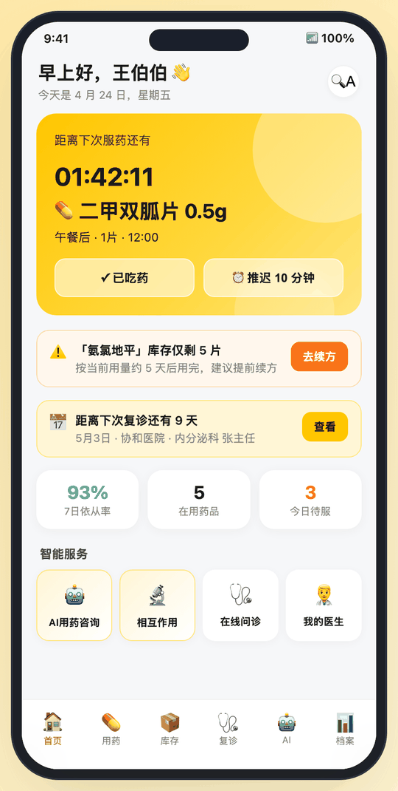
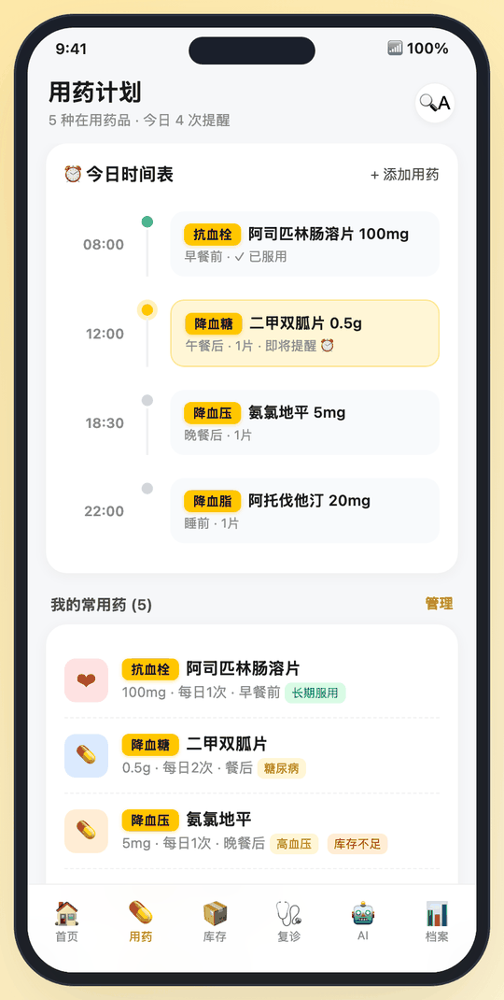
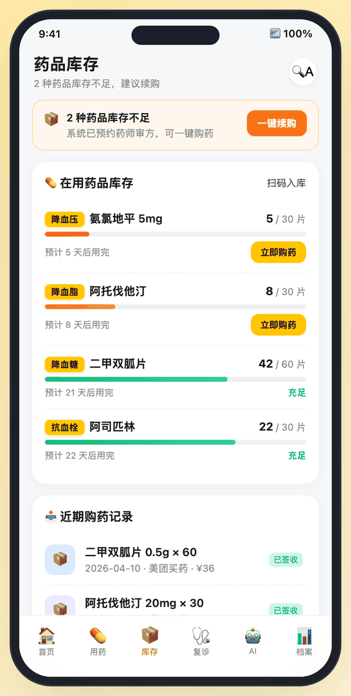
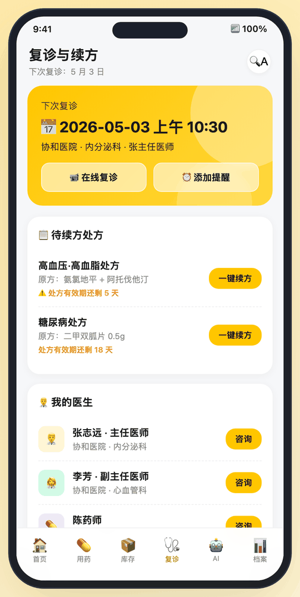
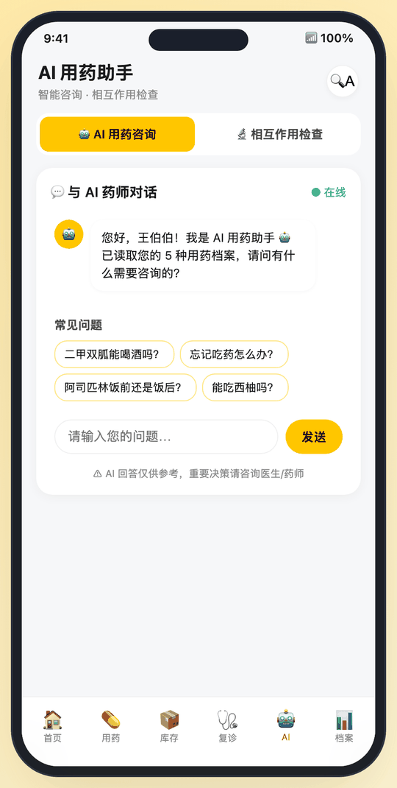
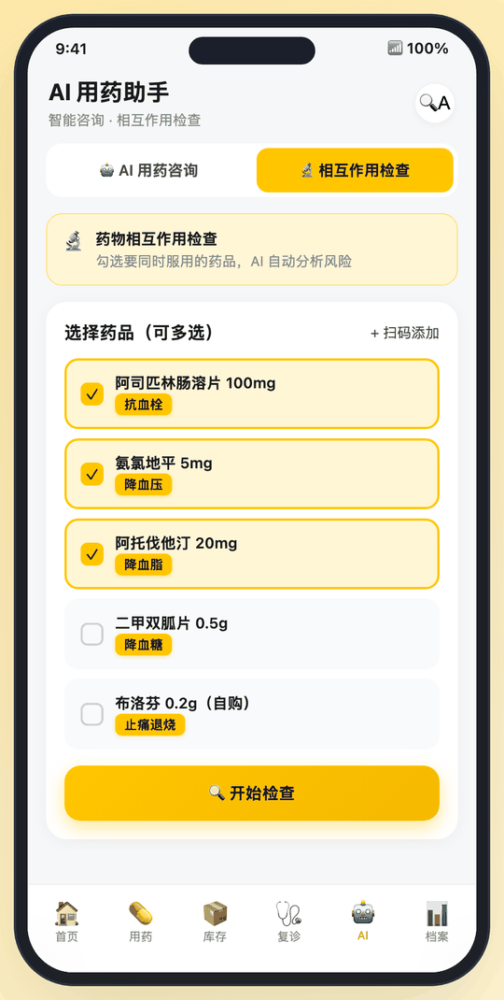
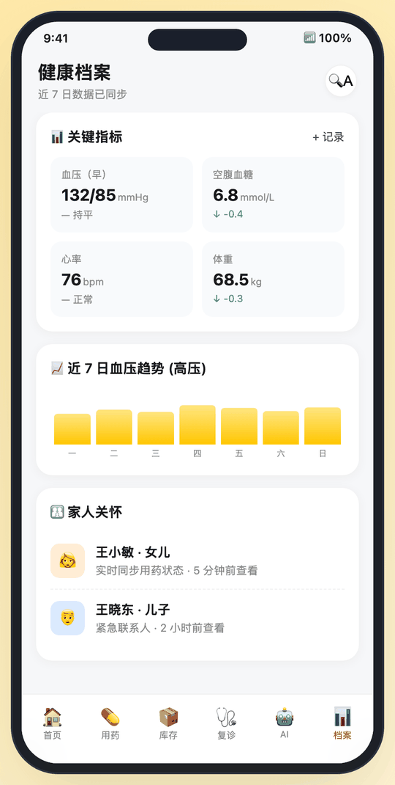
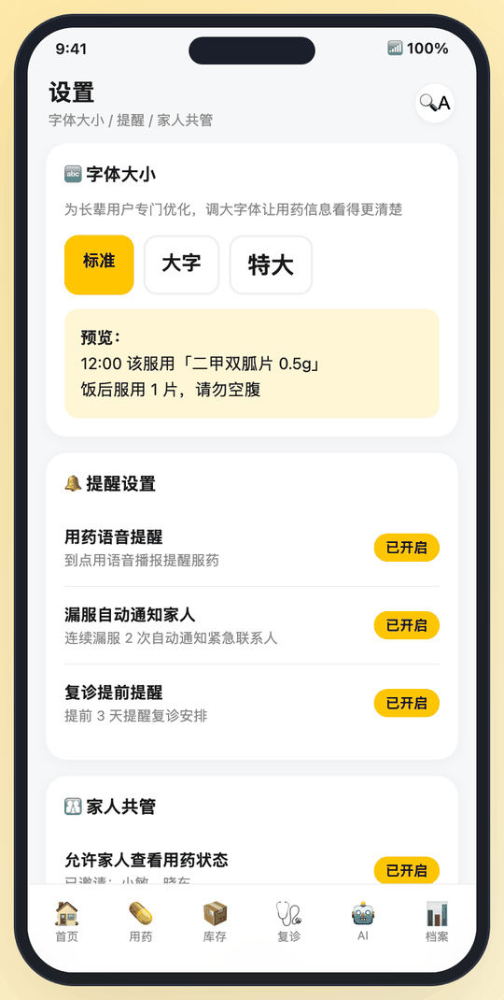

# 慢病用药小管家 · Chronic Medication Assistant

An interactive mobile prototype that helps older adults with chronic conditions take the right pill at the right time, keep enough medicine at home, renew prescriptions on time, and check drug interactions. Family members can follow along.

The prototype is one self-contained `index.html` with no build step and no dependencies. It is styled as a mini-app inside Meituan, with purchases going through 美团买药.

> [!IMPORTANT]
> This is a **design prototype with mock data**. It is not a medical device and not a shipped Meituan product. The drug-interaction results and "AI" answers are hard-coded examples. Nothing in this app is medical advice.

<table>
  <tr>
    <td align="center"><br><sub>首页 Home</sub></td>
    <td align="center"><br><sub>用药 Plan</sub></td>
    <td align="center"><br><sub>库存 Inventory</sub></td>
    <td align="center"><br><sub>复诊 Refill</sub></td>
  </tr>
  <tr>
    <td align="center"><br><sub>AI 用药咨询 Chat</sub></td>
    <td align="center"><br><sub>相互作用检查 Interactions</sub></td>
    <td align="center"><br><sub>档案 Health</sub></td>
    <td align="center"><br><sub>设置 Settings</sub></td>
  </tr>
</table>

## 中文简介

「慢病用药小管家」是面向慢病老年用户的用药管理原型，围绕「按时吃药、药不断供、按时复诊续方、用药安全、家人共管」五个场景设计。首页只保留一个当前最重要的任务（下一次服药倒计时），并聚合库存不足、复诊临近等提醒；每种药品都高亮标注「主要作用」（如 降血压），方便长辈分清每片药是做什么的；支持标准 / 大字 / 特大三档字体。

本项目为交互原型，所有数据均为演示数据，不构成任何医疗建议。

## Features

| Tab | What it does |
| --- | --- |
| **首页 Home** | One main card counts down to the next dose, with **✓ 已吃药** (taken) and **⏰ 推迟 10 分钟** (snooze) buttons. Confirming a dose moves the card on to the next one, and it turns into an "all done today" card after the last dose. The page also shows alerts for low stock and the next follow-up visit, a 3-number summary (7-day adherence, active meds, doses left today), and shortcuts to the AI tools. |
| **用药 Plan** | Today's timeline (taken / next up / later), the full medication list with a highlighted **purpose tag** on each drug, and an add-medication sheet. |
| **库存 Inventory** | Pills left per drug, a color-coded stock bar, an estimated run-out date, one-tap reorder, and recent orders. |
| **复诊 Refill** | The next follow-up visit, prescriptions close to expiry with **一键续方** (one-tap renewal), and the care team (doctors, pharmacist). |
| **AI** | **Chat:** a pharmacist-style assistant with canned answers to common questions (alcohol with metformin, missed doses, when to take aspirin, grapefruit). **Interaction check:** pick 2 or more drugs and see risk levels (high / medium / compatible). |
| **档案 Health** | Key vitals (blood pressure, fasting glucose, heart rate, weight) with trends, a 7-day blood-pressure chart, and the family members who can see adherence. |
| **设置 Settings** | Three font sizes for older eyes (the choice is remembered), reminder settings (voice reminders, alerting family about missed doses, follow-up reminders), and family sharing. Open it with the **🔍A** button in the header. |

### Things to try

1. On Home, tap **✓ 已吃药 → ✓ 已服用**. The countdown moves to the next dose. Repeat for the two remaining doses to reach the 🎉 all-done card.
2. Tap **🔍A** and switch to **特大** (extra large). Every screen scales up, and the setting is still there after a reload.
3. Open **AI → 相互作用检查**, tick 布洛芬 (阿司匹林 is already ticked), then tap **开始检查** to see the high-risk warning.
4. Open **AI → AI 用药咨询** and tap **能吃西柚吗？** The assistant points out the grapefruit interaction with two of the patient's drugs.

## Getting started

No install is needed. Clone the repo and open the file:

```bash
git clone https://github.com/crystaljingjiang/chronic-med-assistant.git
```

```bash
open chronic-med-assistant/index.html
```

On Windows, double-click `index.html` instead. You can also serve the folder locally:

```bash
python3 -m http.server 8000 --directory chronic-med-assistant
```

Then visit <http://localhost:8000>.

On a desktop browser the app is drawn inside a phone frame. Below 500px wide (a real phone) it switches to full screen.

### Deep links

Each screen has its own URL hash, which is handy for demos and for linking to a specific screen:

| URL | Opens |
| --- | --- |
| `index.html` | Home |
| `#plan`, `#inventory`, `#refill`, `#health`, `#settings` | That tab |
| `#ai` | AI chat |
| `#ai/check` | Drug interaction checker |

## Publishing a live demo (GitHub Pages)

The app is a static file, so GitHub Pages can host it as is:

1. On GitHub, open **Settings → Pages**.
2. Under **Build and deployment**, choose **Deploy from a branch**, then pick `main` and `/ (root)`.
3. After about a minute the demo is live at `https://crystaljingjiang.github.io/chronic-med-assistant/`.

## Project structure

```
chronic-med-assistant/
├── index.html           # The whole app: styles, markup and script
├── docs/
│   ├── PRODUCT.md       # Product brief: users, problems, design decisions, roadmap
│   └── screenshots/     # Images used in this README
├── CHANGELOG.md
├── LICENSE
└── README.md
```

## How it works

`index.html` has three parts:

- **`<style>`**: CSS custom properties hold the Meituan-yellow palette (`--mt-yellow`) and a `--base-font` variable. The font-size modes (`body.font-lg`, `body.font-xl`) mostly change that one variable, and text everywhere scales from it.
- **Markup**: each tab is a `<div class="page" id="page-…">`. Only the active page is shown.
- **`<script>`**: plain JavaScript with no framework.
  - `meds` is today's dose schedule. `renderHero()` and `renderTimeline()` redraw from it, so marking a dose as taken updates both views.
  - `NOW_MIN` fixes the demo clock at **10:18 on Friday, 24 April 2026**, so every run of the demo looks the same.
  - `aiAnswers` maps the quick questions to canned replies. Any other question gets a placeholder reply.
  - `runInteractionCheck()` holds three hard-coded drug pairs.
  - `switchPage()` handles tab navigation and keeps the URL hash in sync.

### Changing the demo data

| To change… | Edit |
| --- | --- |
| Today's doses, times and purpose tags | the `meds` array |
| The demo time of day | `NOW_MIN` |
| Header titles and subtitles for each tab | the `titles` object |
| Chat answers | the `aiAnswers` object |
| Interaction rules | `runInteractionCheck()` |
| Stock, prescriptions, doctors, vitals | the static HTML in each `page-…` section |

## Known limitations

These are expected in a prototype. [docs/PRODUCT.md](docs/PRODUCT.md) covers what a real version would need.

- All data is mock data and resets on reload. Only the font size is saved, in `localStorage`.
- The clock is fixed, and reminders don't fire real notifications.
- The add-medication form, reorder, renewal, online consultation and barcode scanning buttons only show a confirmation toast.
- The AI chat answers just four preset questions, and the interaction checker knows just three drug pairs.
- Some static numbers aren't linked to the schedule. For example, 二甲双胍 is listed as twice a day but has one slot on the timeline.
- Tabs and buttons are `div`s with click handlers, so they aren't reachable by keyboard or screen reader yet.

## Browser support

Works in current versions of Chrome, Edge, Safari (16+) and Firefox, on desktop and mobile.

## Medical disclaimer

The drug names, doses, interaction notes and answers in this prototype are for illustration only. They are not medical advice and may be incomplete or out of date. Always follow your doctor's or pharmacist's instructions.

## License

[MIT](LICENSE)
